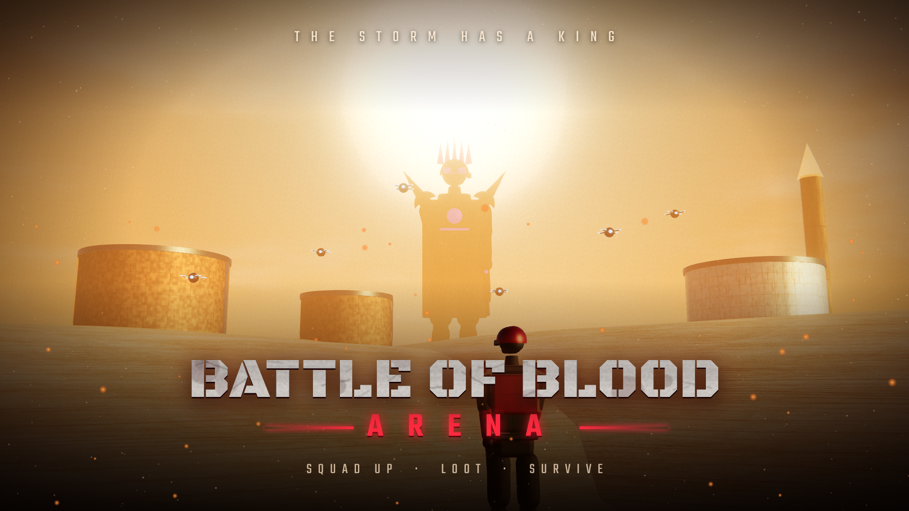

# Battle of Blood: Arena

A 3D first-person shooter that runs in the browser — on PC and on mobile.

**▶ Play free:** https://sauravh-ledger.github.io/Battle-of-Blood/

- 5 big maps: Rainport 9, Neon Chowk, Dustfall Refinery, Himgiri Outpost, Paatal Temple
- Waves of villains (raiders, runners, bombers, riot shields, drones, medics) and the boss KAAL — Storm Warden
- Loot crates, gloo walls, mines and medkits, AI squad, jeep and metro train, dungeon traps
- 9 operators, gun skins, daily missions and a 30-tier Arena Pass

**Controls (PC):** WASD move · mouse aim · click shoot · right-click aim · R reload · 1–4 weapons · Shift sprint · Space jump · Q gloo wall · H medkit · X mine · F/E use · P pause
**Mobile:** left stick to move, drag to aim, on-screen buttons.

Built with [three.js](https://threejs.org) (MIT). Environment maps from [Poly Haven](https://polyhaven.com) (CC0). No trackers — see [PRIVACY.md](PRIVACY.md).

## Custom match: 1 vs 1 and 2 vs 2

A dedicated mode for friends. Press **Custom match** in the menu, then **Create custom match**, and share the code.

- The host chooses **1 VS 1** or **2 VS 2**, the arena and the round format (single round, best of 3, best of 5).
- In the lobby the host moves players between **Blue** and **Red** to decide the teams.
- Small arenas only: Rainport Pit, Neon Gully and Sun Court.
- Every round starts with a **10 second preparation** timer; nobody can move or shoot until it ends.
- Last team standing wins the round. Dead players **spectate** their teammates, then the rivals.
- A little loot is placed on each side, and a supply drop lands mid-fight.
- No jetpack, ODM grapple, boost or vehicles in this mode.

No server change is needed; the existing relay server handles it.
