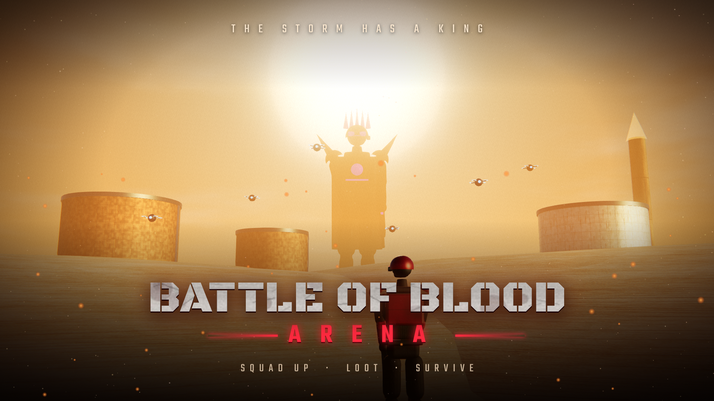

# Battle of Blood: Arena

A 3D first-person shooter that runs in the browser — on PC and on mobile.

**▶ Play free:** https://sauravh-ledger.github.io/battle-of-blood/

- 5 big maps: Rainport 9, Neon Chowk, Dustfall Refinery, Himgiri Outpost, Paatal Temple
- Waves of villains (raiders, runners, bombers, riot shields, drones, medics) and the boss KAAL — Storm Warden
- Loot crates, gloo walls, mines and medkits, AI squad, jeep and metro train, dungeon traps
- 9 operators, gun skins, daily missions and a 30-tier Arena Pass

**Controls (PC):** WASD move · mouse aim · click shoot · right-click aim · R reload · 1–4 weapons · Shift sprint · Space jump · Q gloo wall · H medkit · X mine · F/E use · P pause
**Mobile:** left stick to move, drag to aim, on-screen buttons.

Built with [three.js](https://threejs.org) (MIT). Environment maps from [Poly Haven](https://polyhaven.com) (CC0). No trackers — see [PRIVACY.md](PRIVACY.md).
